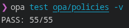

# Control de acceso y motor de autorización (RBAC2 + ABAC)

**Borrador de las secciones 5.1.2, 5.1.6 y Evidencia (5.1.7) del Informe de Implementación · Responsable: Kevin Chinchilla Rodríguez**

> Daniel consolida el informe final. Este archivo contiene las secciones listas
> para integrar; conviene mantenerlo sincronizado con `opa/policies/authz.rego`
> y `opa/policies/authz_test.rego`.

---

## Sección 5.1.2 — Controles implementados (Motor PEP/PDP con OPA)

El sistema implementa el modelo híbrido **RBAC2 + ABAC + HBAC** definido en la
Parte 1. Toda la lógica de autorización vive en el servidor (nunca en la
interfaz de usuario) y separa estrictamente la aplicación que intercepta la
petición del motor que toma la decisión.

### 1. Arquitectura PEP / PDP (Frontera F3)

```
Petición HTTP ──► Django + DRF (PEP) ──[loopback 127.0.0.1:8181]──► OPA (PDP)
                  app/authz/                                        opa/policies/
                    ├─ permissions.py (DenyAll, PermitePorMatriz)      └─ authz.rego
                    └─ pdp.py (DecisionInput, falla cerrada)
```

* **Punto de Aplicación de la Política (PEP — `app/authz/`):**
  * **Denegación por omisión global (`DenyAll`):** Configurado como permiso por
    defecto en `REST_FRAMEWORK`. Cualquier vista nueva que no declare
    explícitamente sus permisos queda cerrada automáticamente.
  * **Evaluación por matriz (`PermitePorMatriz`):** Las vistas declaran el
    recurso (`objeto_tipo`) y la operación (`accion`), y construyen el contexto
    (`construir_atributos`) leyendo el estado real directamente desde la base de
    datos (nunca del cuerpo o parámetros enviados por el cliente).
  * **Cliente del PDP (`app/authz/pdp.py`):** Envía el contrato
    `DecisionInput` al contenedor OPA exclusivamente por interfaz local
    (`127.0.0.1:8181`). Implementa **falla cerrada** (`DENY_ENGINE_DOWN`): si
    el motor no responde, excede el tiempo límite o devuelve un formato
    inesperado, la petición se deniega automáticamente.

* **Punto de Decisión de la Política (PDP — `opa/policies/authz.rego`):**
  * Corre como contenedor *sidecar* en la misma instancia de Cloud Run sin
    puerto expuesto al exterior (Frontera F3).
  * Evalúa la matriz de control de acceso escrita en **Rego v1** bajo la regla
    `default allow := false` (denegar por omisión).
  * Devuelve un objeto estructurado `decision` con cinco campos: `allow`,
    `rule_id`, `rule_ver`, `obligations` (p. ej. `mfa_reciente`,
    `alerta_frecuencia_c5`) y `reason`.

### 2. Restricciones de sesión (RBAC2) y reglas condicionadas (ABAC / HBAC)

* **Rol activo único por sesión:** Aunque una persona tenga asignados varios
  roles (p. ej., Técnico de campo y Verificador), en la sesión solo mantiene un
  `rol_activo` a la vez, leído del servidor. Un usuario con rol activo de
  Técnico no puede invocar acciones de Verificador ni viceversa.
* **Celdas incondicionales (`permisos_simples`):** Agrupan las operaciones de
  lectura o gestión que no dependen de atributos contextuales del registro ni
  de separación dinámica de funciones.
* **Celdas condicionadas (`C1`–`C6`, `S1`, `S2`):**

| Regla | Rol × Objeto (Acciones) | Condiciones verificadas en el servidor | Obligaciones / Controles |
|---|---|---|---|
| **C1** | Técnico de campo × Medición (`Create`, `Update`, `Read`) | Finca asignada (`S1`), período abierto, estado en `borrador` o `devuelta`, y el usuario es el autor (`es_autor == true`). Para `Read` solo exige `finca_asignada` y `es_autor`. | Evita edición tras el envío o cierre del período. |
| **C2** | Verificador × Medición (`Approve`, `Return`) | Estado `enviada`, el usuario no es autor (`es_autor == false`) ni editor previo (`fue_editor == false`), y cuenta con MFA reciente (`mfa_reciente == true`). | **SoD estricta** + `obligations: ["mfa_reciente"]`. |
| **C3** | Verificador × Certificado (`Create`) | Medición en estado `aprobada`, no existe certificado vigente en la parcela/período (`existe_cert_vigente == false`), y el verificador no es el autor de la medición. | Impide doble emisión y autoaprobación. |
| **C4** | Técnico × Enmienda (`Create`, `Read`) / Gerencia × Enmienda (`Authorize`) | Período cerrado (`periodo_abierto == false`), solicitud con motivo (`tiene_motivo == true`), finca asignada (para Técnico) y quien autoriza es distinto del solicitante (`actor != solicitante`). | **Doble control** tras el cierre del período. |
| **S1 + C5** | Técnico de campo × Finca (`Read`) | Finca asignada (`S1`). Control HBAC sobre `fincas_leidas_24h` ($n$): $n \le 20$ permitido; $20 < n \le 60$ permitido solo con MFA reciente y alerta; $n > 60$ denegado con alerta. | `mfa_reciente` y `alerta_frecuencia_c5`. |
| **C6** | Administrador × Cuenta (`Create`, `Update`, `Deactivate`) / Gerencia × Cuenta (`Approve`) | Existencia de solicitud escrita (`tiene_solicitud == true`); el ejecutor no es el beneficiario (`actor != beneficiario`) y quien aprueba no es el ejecutor (`actor != ejecutor`). | **Doble control** en ciclo de vida de cuentas. |
| **S2** | Dueño de finca × Finca, Período, Medición, Enmienda (`Read`), Certificado (`Read`, `Download`) | El usuario es el propietario registrado de la finca (`es_propietario == true`). | Aislamiento entre propietarios competidores. |

### 3. Verificación automatizada en Integración Continua

En `.github/workflows/ci.yml`, cada *push* y *pull request* ejecuta `opa check`
y `opa test` sobre `opa/policies/`. La política actual cuenta con **55 pruebas
unitarias** aprobadas (`55/55 PASS`) y una cobertura de líneas del **99.4 %** en
`authz.rego` (170 de 171 líneas evaluadas) y **100 %** en `authz_test.rego`.

---

## Sección 5.1.6 — Cobertura de la matriz

La siguiente tabla detalla la cobertura **permiso por permiso** de la matriz
diseñada en la Parte 1 (`P1_Matriz_grupo7.tex`), indicando en qué regla de
`opa/policies/authz.rego` está implementada y con qué prueba unitaria de
`opa/policies/authz_test.rego` se comprobó.

### 1. Técnico de campo

| Objeto | Permiso en la Matriz | Implementado en (`opa/policies/authz.rego`) | Comprobado con (`opa/policies/authz_test.rego`) |
|---|---|---|---|
| **Finca** | `Read` (S1, C5) | Reglas `S1` + `C5` (`finca_asignada`, umbrales 20/60 en 24h) | `test_s1_c5_tecnico_frecuencia_normal`, `test_s1_finca_no_asignada_se_deniega`, `test_c5_frecuencia_media_con_mfa_permite_y_alerta`, `test_c5_frecuencia_media_sin_mfa_se_deniega`, `test_c5_frecuencia_alta_excede_umbral_se_deniega` |
| **Período** | `Read` | `permisos_simples` (`rule_id = "MATRIZ_SIMPLE"`) | `test_tecnico_lee_periodo` |
| **Medición** | `Create`, `Update`, `Read` (C1) | Regla `C1` (`finca_asignada`, `periodo_abierto`, `estado_objeto`, `es_autor`) | `test_c1_tecnico_crea_medicion_en_periodo_abierto`, `test_c1_tecnico_actualiza_medicion_devuelta`, `test_c1_tecnico_lee_medicion_propia`, `test_c1_periodo_cerrado_se_deniega`, `test_c1_finca_no_asignada_se_deniega`, `test_c1_no_es_autor_se_deniega`, `test_c1_estado_enviada_no_permite_update` |
| **Enmienda** | `Create`, `Read` propias (C4) | Regla `C4` (`periodo_abierto == false`, `tiene_motivo`, `finca_asignada`, `es_autor`) | `test_c4_tecnico_crea_enmienda_valida`, `test_c4_tecnico_lee_enmienda_propia`, `test_c4_tecnico_crea_enmienda_periodo_abierto_se_deniega`, `test_c4_tecnico_crea_enmienda_sin_motivo_se_deniega` |
| **Certificado** | `DENIED` | `default allow := false` (`DENY_DEFAULT`) | `test_tecnico_no_emite_certificado` |
| **Cuenta** | `DENIED` | `default allow := false` (`DENY_DEFAULT`) | Cubierto por denegación por omisión (`default allow := false`) |
| **Bitácora** | `DENIED` | `default allow := false` (`DENY_DEFAULT`) | `test_tecnico_no_lee_bitacora`, `test_objeto_decision_denegado_por_defecto` |

### 2. Verificador

| Objeto | Permiso en la Matriz | Implementado en (`opa/policies/authz.rego`) | Comprobado con (`opa/policies/authz_test.rego`) |
|---|---|---|---|
| **Finca** | `Read` | `permisos_simples` (`MATRIZ_SIMPLE`) | `test_verificador_permisos_simples` |
| **Período** | `Read` | `permisos_simples` (`MATRIZ_SIMPLE`) | `test_verificador_permisos_simples` |
| **Medición** | `Read` | `permisos_simples` (`MATRIZ_SIMPLE`) | `test_verificador_permisos_simples` |
| **Medición** | `Approve`, `Return` (C2) | Regla `C2` (`estado_objeto == "enviada"`, `es_autor == false`, `fue_editor == false`, `mfa_reciente == true`) | `test_c2_verificador_aprueba_medicion_valida`, `test_c2_verificador_devuelve_medicion_valida`, `test_c2_sod_verificador_es_autor_se_deniega`, `test_c2_sod_verificador_fue_editor_se_deniega`, `test_c2_sin_mfa_reciente_se_deniega`, `test_c2_estado_borrador_no_se_puede_aprobar`, `test_c2_tecnico_no_puede_aprobar_medicion` |
| **Enmienda** | `Read` (concepto técnico) | `permisos_simples` (`MATRIZ_SIMPLE`) | `test_verificador_permisos_simples` |
| **Certificado** | `Create` (C3) | Regla `C3` (`estado_objeto == "aprobada"`, `existe_cert_vigente == false`, `es_autor == false`) | `test_c3_verificador_crea_certificado_valido`, `test_c3_medicion_no_aprobada_se_deniega`, `test_c3_existe_certificado_vigente_se_deniega`, `test_c3_sod_verificador_autor_de_medicion_se_deniega` |
| **Certificado** | `Read`, `Download` | `permisos_simples` (`MATRIZ_SIMPLE`) | `test_verificador_permisos_simples` |
| **Cuenta** | `DENIED` | `default allow := false` (`DENY_DEFAULT`) | `test_verificador_no_administra_cuentas` |
| **Bitácora** | `DENIED` | `default allow := false` (`DENY_DEFAULT`) | Cubierto por denegación por omisión (`default allow := false`) |

### 3. Administrador

| Objeto | Permiso en la Matriz | Implementado en (`opa/policies/authz.rego`) | Comprobado con (`opa/policies/authz_test.rego`) |
|---|---|---|---|
| **Finca** | `Create`, `Read`, `Update`, `Deactivate` | `permisos_simples` (`MATRIZ_SIMPLE`) | `test_administrador_gestiona_fincas_y_lee_periodo` |
| **Período** | `Read` | `permisos_simples` (`MATRIZ_SIMPLE`) | `test_administrador_gestiona_fincas_y_lee_periodo` |
| **Medición** | `DENIED` | `default allow := false` (`DENY_DEFAULT`) | `test_administrador_no_toca_mediciones` |
| **Enmienda** | `DENIED` | `default allow := false` (`DENY_DEFAULT`) | Cubierto por denegación por omisión (`default allow := false`) |
| **Certificado** | `DENIED` | `default allow := false` (`DENY_DEFAULT`) | Cubierto por denegación por omisión (`default allow := false`) |
| **Cuenta** | `Create`, `Update`, `Deactivate` (C6) | Regla `C6` (`tiene_solicitud == true`, `actor != beneficiario`) | `test_c6_administrador_crea_cuenta_valida`, `test_c6_administrador_actualiza_y_desactiva_cuenta`, `test_c6_sod_administrador_ejecuta_para_si_mismo_se_deniega`, `test_c6_administrador_sin_solicitud_se_deniega` |
| **Bitácora** | `DENIED` | `default allow := false` (`DENY_DEFAULT`) | `test_administrador_no_lee_bitacora` |

### 4. Auditor externo

| Objeto | Permiso en la Matriz | Implementado en (`opa/policies/authz.rego`) | Comprobado con (`opa/policies/authz_test.rego`) |
|---|---|---|---|
| **Finca** | `Read` | `permisos_simples` (`MATRIZ_SIMPLE`) | `test_auditor_lee_todo_y_descarga_certificado` |
| **Período** | `Read` | `permisos_simples` (`MATRIZ_SIMPLE`) | `test_auditor_lee_todo_y_descarga_certificado` |
| **Medición** | `Read` | `permisos_simples` (`MATRIZ_SIMPLE`) | `test_auditor_lee_todo_y_descarga_certificado` |
| **Enmienda** | `Read` | `permisos_simples` (`MATRIZ_SIMPLE`) | `test_auditor_lee_todo_y_descarga_certificado` |
| **Certificado** | `Read`, `Download` | `permisos_simples` (`MATRIZ_SIMPLE`) | `test_auditor_lee_todo_y_descarga_certificado` |
| **Cuenta** | `DENIED` | `default allow := false` (`DENY_DEFAULT`) | Cubierto por denegación por omisión (`default allow := false`) |
| **Bitácora** | `Read` | `permisos_simples` (`MATRIZ_SIMPLE`) | `test_auditor_lee_todo_y_descarga_certificado` |

### 5. Dueño de finca

| Objeto | Permiso en la Matriz | Implementado en (`opa/policies/authz.rego`) | Comprobado con (`opa/policies/authz_test.rego`) |
|---|---|---|---|
| **Finca** | `Read` (S2) | Regla `S2` (`es_propietario == true`) | `test_s2_dueno_lee_recursos_de_su_finca`, `test_s2_dueno_no_propietario_se_deniega`, `test_s2_dueno_no_puede_crear_ni_editar` |
| **Período** | `Read` (S2) | Regla `S2` (`es_propietario == true`) | `test_s2_dueno_lee_recursos_de_su_finca` |
| **Medición** | `Read` (S2) | Regla `S2` (`es_propietario == true`) | `test_s2_dueno_lee_recursos_de_su_finca`, `test_s2_dueno_no_puede_crear_ni_editar` |
| **Enmienda** | `Read` (S2) | Regla `S2` (`es_propietario == true`) | `test_s2_dueno_lee_recursos_de_su_finca` |
| **Certificado** | `Read`, `Download` (S2) | Regla `S2` (`es_propietario == true`) | `test_s2_dueno_lee_recursos_de_su_finca`, `test_s2_dueno_no_propietario_se_deniega` |
| **Cuenta** | `DENIED` | `default allow := false` (`DENY_DEFAULT`) | `test_s2_dueno_no_lee_bitacora_ni_cuentas` |
| **Bitácora** | `DENIED` | `default allow := false` (`DENY_DEFAULT`) | `test_s2_dueno_no_lee_bitacora_ni_cuentas` |

### 6. Gerencia de Certificación

| Objeto | Permiso en la Matriz | Implementado en (`opa/policies/authz.rego`) | Comprobado con (`opa/policies/authz_test.rego`) |
|---|---|---|---|
| **Finca** | `Read` | `permisos_simples` (`MATRIZ_SIMPLE`) | `permisos_simples["Gerencia de Certificacion"]` + evaluación en `authz.rego` |
| **Período** | `Open`, `Close`, `Read` | `permisos_simples` (`MATRIZ_SIMPLE`) | `test_gerencia_permisos_simples` |
| **Medición** | `Read` | `permisos_simples` (`MATRIZ_SIMPLE`) | `permisos_simples["Gerencia de Certificacion"]` |
| **Enmienda** | `Read` | `permisos_simples` (`MATRIZ_SIMPLE`) | `permisos_simples["Gerencia de Certificacion"]` |
| **Enmienda** | `Authorize` (C4) | Regla `C4` (`periodo_abierto == false`, `actor != solicitante`) | `test_c4_gerencia_autoriza_enmienda_valida`, `test_c4_sod_gerencia_autoriza_su_propia_solicitud_se_deniega` |
| **Certificado** | `Read`, `Revoke` | `permisos_simples` (`MATRIZ_SIMPLE`) | `test_gerencia_permisos_simples` |
| **Cuenta** | `Read` | `permisos_simples` (`MATRIZ_SIMPLE`) | `test_gerencia_permisos_simples` |
| **Cuenta** | `Approve` (C6) | Regla `C6` (`tiene_solicitud == true`, `actor != ejecutor`) | `test_c6_gerencia_aprueba_cuenta_valida`, `test_c6_sod_gerencia_aprueba_su_propia_ejecucion_se_deniega` |
| **Bitácora** | `Read` | `permisos_simples` (`MATRIZ_SIMPLE`) | `test_gerencia_permisos_simples` |

### 7. Controles transversales y entradas inválidas

| Control | Implementado en (`opa/policies/authz.rego`) | Comprobado con (`opa/policies/authz_test.rego`) |
|---|---|---|
| Denegación sin rol / rol inexistente | `default allow := false` + `roles_validos` | `test_sin_rol_se_deniega`, `test_rol_inventado_se_deniega` |
| Objeto o acción inexistente (`Delete`) | `objetos_validos` + `default allow := false` | `test_objeto_inventado_se_deniega`, `test_accion_inventada_se_deniega` |
| Contrato completo de respuesta (`Decision`) | Regla `decision := {...}` | `test_objeto_decision_completo`, `test_objeto_decision_denegado_por_defecto` |

---

## Sección 5.1.7 — Evidencia (Intento fallido por rol no autorizado)

> **Instrucción para completar antes de entregar:** Ejecutar una prueba real de
> denegación (p. ej. un Técnico de campo intentando aprobar una medición o
> emitir un certificado, o un Administrador intentando leer la bitácora) y pegar
> aquí la captura de pantalla.

* **Evidencia 1 — Respuesta del sistema / PDP ante acceso denegado (`403 Forbidden` / `allow: false`):**
  * `[PENDIENTE: adjuntar captura de pantalla del intento fallido y su registro AUTHZ.DENY en bitácora]`

* **Evidencia 2 — Ejecución de la suite de pruebas (`opa test opa/policies -v`):**
  
